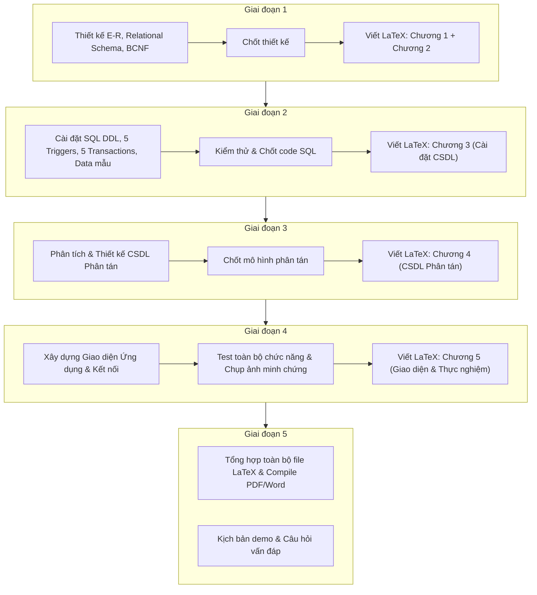

# KẾ HOẠCH TRIỂN KHAI BÀI TẬP LỚN CÁC HỆ THỐNG CSDL
**Môn học:** Các hệ thống CSDL - Mã lớp: M26CQ02  
**Đề tài 13:** Xây dựng Hệ CSDL quản lý một giải bóng đá chuyên nghiệp  
**Nhóm thực hiện:** Nhóm 2  
* **Danh sách thành viên:**
  1. Hoàng Anh Tuấn - MSV: B26CHHT102 (Trưởng nhóm)
  2. Đào Duy Thông - MSV: B26CHHT095
  3. Nguyễn Hoàng Mạnh Dũng - MSV: B26CHHT026
  4. Hồ Quang Anh - MSV: B26CHHT005
  5. Nguyễn Thị Ngọc Bích - MSV: B26CHHT010
  6. Nguyễn Ngọc Quang - MSV: B26CHHT086
  7. Hoàng Minh Dũng - MSV: B26CHHT027
**Quy cách nộp:** Báo cáo duy nhất định dạng MS Word / PDF; Tiêu đề chuẩn `[M26CQHT02] nhóm 2_QLBongDa`

---

## I. MỤC TIÊU VÀ QUY CÁCH CHẤM ĐIỂM
* **Phần 2 (30% điểm):** 
  * Báo cáo phân tích thiết kế CSDL (Mức khái niệm, logic, chuẩn hóa BCNF).
  * Cài đặt CSDL SQL (đầy đủ bảng, dữ liệu mẫu 1 mùa giải, $\ge 5$ Triggers, $\ge 5$ Transactions).
  * Thiết kế CSDL Phân tán (Phân mảnh, định vị, nhân bản, sơ đồ tổng quát).
  * Xây dựng giao diện ứng dụng kết nối CSDL, demo các nghiệp vụ.
  * Hạn nộp báo cáo tổng thể: 23h59 ngày 22/11/2026.
* **Phần 3 (60% điểm):** Vận hành hệ thống và vấn đáp trực tiếp từng thành viên trong ngày thi.

---

## II. THÔNG SỐ VÀ NGHIỆP VỤ BÀI TOÁN (ĐỀ TÀI 13)

### 1. Quy mô & Thể thức giải đấu
* **Số đội tham gia:** 6 đội bóng (Đảm bảo số chẵn $\ge 6$).
* **Thể thức thi đấu:** Vòng tròn 2 lượt (Lượt đi sân nhà, Lượt về sân khách).
* **Số vòng đấu:** $2 \times (6 - 1) = 10$ vòng đấu.
* **Số trận đấu:** Mỗi vòng 3 trận $\rightarrow$ Toàn mùa giải gồm $10 \times 3 = 30$ trận đấu.
* **Toàn bộ dữ liệu của 1 mùa giải (30 trận)** phải được nạp đầy đủ vào CSDL.

### 2. Các ràng buộc nghiệp vụ chi tiết
1. **Đội bóng & Sân đấu & Màu áo:**
   * Mỗi đội bóng có đúng 1 sân nhà cố định. Một sân có thể là sân nhà của $\ge 1$ đội bóng.
   * Mỗi đội bóng có tối thiểu 2 màu áo (áo sân nhà, áo sân khách,...).
   * Mỗi đội có tối đa 30 cầu thủ đang thi đấu.
2. **Cầu thủ & Số áo & Hợp đồng:**
   * Cầu thủ ký hợp đồng chuyên nghiệp với 1 đội; có thể cho mượn sang đội khác.
   * Tại một thời điểm, mỗi cầu thủ chỉ thi đấu cho đúng 1 đội.
   * Số áo cầu thủ nằm trong khoảng từ **1 đến 35**.
   * Trong cùng 1 đội, số áo các cầu thủ phải khác nhau; khác đội có thể trùng số áo.
3. **Trận đấu & Trọng tài:**
   * Trạng thái trận đấu: `ChuaDienRa` hoặc `DaKetThuc`.
   * Ngày giờ diễn ra trận đấu $\le$ ngày hiện tại (nếu đã kết thúc).
   * Mỗi trận đấu có đủ **4 trọng tài**: 1 trọng tài chính, 2 trọng tài biên, 1 trọng tài bàn.
   * **Ràng buộc trọng tài:** 1 trọng tài chỉ được điều khiển tối đa **1 trận đấu trong 1 vòng đấu**.
4. **Danh sách thi đấu & Diễn biến trận:**
   * Mỗi đội đăng ký tối đa **18 cầu thủ** cho mỗi trận đấu.
   * Lưu thông tin chi tiết từng bàn thắng, thẻ vàng, thẻ đỏ của từng cầu thủ.
   * **Ràng buộc khớp kết quả:** Tổng số bàn thắng và thẻ phạt của các cầu thủ phải khớp chính xác với tỉ số và số thẻ ghi nhận của trận đấu.

### 3. Nghiệp vụ tính toán & Báo cáo
* **Bảng xếp hạng (BXH):** 
  * Điểm số: Thắng = 3 điểm, Hòa = 1 điểm, Thua = 0 điểm.
  * Tiêu chí xếp hạng ưu tiên: **Điểm** $\rightarrow$ **Hiệu số** (Bàn thắng - Bàn thua) $\rightarrow$ **Tổng bàn thắng** $\rightarrow$ **Số trận thắng sân khách** $\rightarrow$ **Tổng số thẻ đỏ (ít hơn)** $\rightarrow$ **Tổng số thẻ vàng (ít hơn)**.
* **Top 10 Vua phá lưới:** 10 cầu thủ có tổng số bàn thắng cao nhất giải.
* **Tính lương trọng tài theo tháng:**
  * Trọng tài chính: $3.000.000$ VNĐ / trận.
  * Trọng tài biên: $2.000.000$ VNĐ / trận.
  * Trọng tài bàn: $1.000.000$ VNĐ / trận.
* **Doanh thu sân vận động:** Tính theo từng trận và tổng hợp: $\text{Doanh thu} = \text{Số khán giả} \times \text{Giá vé mỗi trận}$.
* **Thống kê vòng đấu:** Thống kê chi tiết kết quả, bàn thắng, thẻ phạt theo từng vòng.

---

## III. KẾ HOẠCH TRIỂN KHAI CHI TIẾT (5 GIAI ĐOẠN)

> **Nguyên tắc thực hiện:** Tại mỗi giai đoạn, sau khi triển khai và **chốt hoàn thiện 100% nội dung kỹ thuật**, chúng ta sẽ tiến hành **viết ngay mã nguồn LaTeX cho chương tương ứng** của báo cáo. Cách làm này đảm bảo nội dung chuẩn xác một lần, không phải chỉnh sửa qua lại nhiều lần và khi kết thúc các giai đoạn sẽ có ngay một bản báo cáo hoàn chỉnh.

---

### GIAI ĐOẠN 1: THIẾT KẾ DỮ LIỆU MỨC KHÁI NIỆM, LOGIC VÀ CHUẨN HÓA BCNF
* **Công việc cụ thể:**
  1. Phân tích từ điển dữ liệu và các thực thể:
     * `SAN_VAN_DONG` (MaSan, TenSan, DiaChi, SucChua)
     * `DOI_BONG` (MaDoi, TenDoi, HLV, MaSanNha)
     * `MAU_AO` (MaMau, MaDoi, LoaiMauAo, MoTa)
     * `CAU_THU` (MaCauThu, HoTen, NgaySinh, ViTri, QuocTich)
     * `HOP_DONG_THI_DAU` (MaHD, MaCauThu, MaDoiChuQuan, MaDoiHienTai, SoAo, NgayBatDau, NgayKetThuc, TrangThaiMuon)
     * `TRONG_TAI` (MaTrongTai, HoTen, NgaySinh, QueQuan, CapBac)
     * `VONG_DAU` (MaVong, TenVong, ThuTu)
     * `TRAN_DAU` (MaTran, MaVong, MaDoiNha, MaDoiKhach, MaSan, NgayGio, GiaVe, SoKhach, BanThangNha, BanThangKhach, TheVangNha, TheVangKhach, TheDoNha, TheDoKhach, TrangThai)
     * `PHAN_CONG_TRONG_TAI` (MaTran, MaTrongTai, VaiTro: 'Chinh', 'Bien1', 'Bien2', 'Ban')
     * `DANG_KY_THI_DAU` (MaTran, MaDoi, MaCauThu, LoaiCauThu: 'ChinhThuc', 'DuBi')
     * `SU_KIEN_TRAN_DAU` (MaSuKien, MaTran, MaCauThu, MaDoi, LoaiSuKien: 'BanThang', 'TheVang', 'TheDo', PhutGhiNhan)
  2. Vẽ **Lược đồ E-R chi tiết** (Entity-Relationship Diagram) và viết mô tả cụ thể từng mối quan hệ (1-1, 1-N, N-N).
  3. Ánh xạ từ E-R sang **Lược đồ quan hệ** (xác định rõ ràng Khóa chính - PK, Khóa ngoại - FK).
  4. Xác định tập **Phụ thuộc hàm (F)** cho từng bảng và chứng minh mọi bảng đều đạt **Dạng chuẩn BCNF (Boyce-Codd Normal Form)**.
* **Kết quả bàn giao:** Tài liệu thiết kế E-R, mô hình quan hệ, bảng phụ thuộc hàm và chứng minh BCNF.

---

### GIAI ĐOẠN 2: CÀI ĐẶT CSDL SQL, TRIGGERS, TRANSACTIONS & DỮ LIỆU MẪU
* **Công việc cụ thể:**
  1. **Script DDL (Tạo bảng & Ràng buộc Check):**
     * Tạo toàn bộ các bảng với đầy đủ PK, FK, Index và các CHECK constraints (`SoAo BETWEEN 1 AND 35`, trạng thái trận đấu,...).
  2. **Viết 5 Triggers nghiệp vụ (Bắt buộc):**
     * `TRG_CheckSoAoDuyNhat`: Đảm bảo trong cùng 1 đội không có 2 cầu thủ trùng số áo.
     * `TRG_CheckGioiHan30CauThu`: Đảm bảo 1 đội không được có quá 30 cầu thủ còn hạn thi đấu.
     * `TRG_CheckTrongTaiToiDa1Tran1Vong`: Đảm bảo 1 trọng tài chỉ được phân công tối đa 1 trận trong cùng 1 vòng đấu.
     * `TRG_CheckDangKyToiDa18CauThu`: Giới hạn mỗi đội chỉ được đăng ký tối đa 18 cầu thủ trong 1 trận đấu.
     * `TRG_CheckKhopBanThangVaThe`: Kiểm tra tổng số bàn thắng, thẻ phạt trong bảng sự kiện khớp đúng với kết quả lưu ở bảng trận đấu.
  3. **Viết 5 Transactions nghiệp vụ (Bắt buộc):**
     * `TX1_TaoLichThiDauVong`: Khởi tạo lịch thi đấu cho 1 vòng đấu, kiểm tra cặp đấu sân nhà/khách hợp lệ.
     * `TX2_PhanCongToTrongTai`: Gán đủ 4 trọng tài (1 chính, 2 biên, 1 bàn) cho 1 trận đấu, kiểm tra xung đột lịch.
     * `TX3_DangKyDanhSachThiDau`: Đăng ký danh sách tối đa 18 cầu thủ thi đấu cho 1 trận.
     * `TX4_GhiNhanKetQuaTranDau`: Cập nhật tỉ số, chi tiết bàn thắng, thẻ phạt, số lượng khán giả, doanh thu vé, đổi trạng thái trận sang `DaKetThuc`.
     * `TX5_ChuyenNhuongChoMuonCauThu`: Thực hiện cho mượn/chuyển nhượng cầu thủ sang đội mới, cập nhật số áo mới và kiểm tra điều kiện $\le 30$ cầu thủ.
  4. **Viết Stored Procedures / Views truy vấn thống kê:**
     * View/Procedure tính **Bảng xếp hạng** theo đúng thứ tự ưu tiên đề bài.
     * Procedure tính **Top 10 Vua phá lưới**.
     * Procedure tính **Lương trọng tài theo tháng** (Chính 3tr, Biên 2tr, Bàn 1tr).
     * Procedure thống kê **Doanh thu sân vận động**.
     * Procedure thống kê **Chi tiết vòng đấu**.
  5. **Bộ dữ liệu mẫu (Dummy Data):**
     * Tạo dữ liệu thực tế cho 6 đội bóng, danh sách sân, cầu thủ, trọng tài.
     * Tạo trọn vẹn dữ liệu cho **10 vòng đấu = 30 trận đấu** (lịch thi đấu, danh sách đăng ký, kết quả, sự kiện bàn thắng, thẻ phạt).
* **Kết quả bàn giao:** Toàn bộ file script `.sql` hoàn chỉnh, có thể chạy 1 click để dựng CSDL hoàn thiện.

---

### GIAI ĐOẠN 3: PHÂN TÍCH VÀ THIẾT KẾ CSDL PHÂN TÁN (CSDLPT)
* **Công việc cụ thể:**
  1. **Mô hình giả định phân tán theo Chi nhánh:**
     * Site 0: Server Trung tâm điều hành giải đấu.
     * Site 1: Chi nhánh Miền Bắc (quản lý các sân và các trận đấu diễn ra tại miền Bắc).
     * Site 2: Chi nhánh Miền Nam (quản lý các sân và các trận đấu diễn ra tại miền Nam).
  2. **Chiến lược phân mảnh (Fragmentation):**
     * **Phân mảnh ngang nguyên thủy:** Phân mảnh bảng `SAN_VAN_DONG` và `TRAN_DAU` theo khu vực địa lý (`MienBac`, `MienNam`).
     * **Phân mảnh ngang dẫn xuất:** Phân mảnh bảng `DANG_KY_THI_DAU`, `SU_KIEN_TRAN_DAU` dựa theo `MaTran` của bảng `TRAN_DAU` tại từng site.
     * **Phân mảnh dọc:** Phân mảnh bảng `HOP_DONG_THI_DAU` (tách riêng các thông tin nhạy cảm về tài chính, mức phí chuyển nhượng chỉ lưu tại Server Trung tâm).
     * **Nhân bản (Replication):** Bảng danh mục `DOI_BONG`, `TRONG_TAI`, `VONG_DAU` nhân bản toàn bộ về cả 2 Site để tối ưu hóa truy vấn đọc cục bộ.
  3. **Định vị dữ liệu (Allocation) & Tái thiết lập dữ liệu:**
     * Ma trận định vị dữ liệu trên các Site.
     * Chứng minh tính đúng đắn của phân mảnh: Tính đầy đủ (Completeness), Tính tái thiết được (Reconstruction), Tính tách biệt (Disjointness).
  4. **Vẽ Sơ đồ CSDL Phân tán tổng quát của hệ thống.**
* **Kết quả bàn giao:** Bản tài liệu phân tích CSDLPT đầy đủ công thức vị từ, ma trận định vị và sơ đồ kiến trúc phân tán.

---

### GIAI ĐOẠN 4: XÂY DỰNG GIAO DIỆN ỨNG DỤNG
* **Công việc cụ thể:**
  1. Khởi tạo ứng dụng kết nối trực tiếp với CSDL.
  2. **Module 1 - Quản trị Danh mục (CRUD & Tìm kiếm):**
     * Quản lý Đội bóng, Sân vận động, Màu áo.
     * Quản lý Cầu thủ, Hợp đồng, Số áo.
     * Quản lý Trọng tài.
  3. **Module 2 - Quản lý Thi đấu & Nghiệp vụ Trận đấu:**
     * Lập lịch thi đấu theo vòng.
     * Phân công 4 trọng tài cho từng trận đấu.
     * Đăng ký danh sách 18 cầu thủ trước trận.
     * Ghi nhận kết quả trận đấu, cập nhật sự kiện bàn thắng, thẻ vàng, thẻ đỏ, số khán giả, giá vé.
  4. **Module 3 - Thống kê & Báo cáo:**
     * Màn hình Bảng xếp hạng giải đấu (tự động cập nhật theo đúng tiêu chí xếp hạng).
     * Màn hình Top 10 Vua phá lưới.
     * Màn hình Tính lương trọng tài theo tháng.
     * Màn hình Doanh thu các sân thi đấu.
     * Màn hình Thống kê diễn biến theo vòng đấu.
* **Kết quả bàn giao:** Mã nguồn ứng dụng hoàn chỉnh, chạy ổn định, giao diện rõ ràng, dễ demo.

---

### GIAI ĐOẠN 5: SOẠN THẢO BÁO CÁO TỔNG THỂ & CHUẨN BỊ DEMO
* **Công việc cụ thể:**
  1. Soạn thảo file Báo cáo tổng thể định dạng MS Word / PDF theo đúng khung yêu cầu của giáo viên:
     * **Mục 1:** Phân tích các yêu cầu về dữ liệu cần lưu trữ, các nghiệp vụ và ứng dụng triển khai.
     * **Mục 2:** Lược đồ E-R và bản mô tả chi tiết các thành phần.
     * **Mục 3:** Lược đồ quan hệ (PK-FK), tập phụ thuộc hàm và các bước chuẩn hóa về BCNF.
     * **Mục 4:** Cài đặt CSDL, minh chứng dữ liệu mẫu đã nạp, mô tả chi tiết 5 Trigger, 5 Transaction, chụp ảnh minh chứng tất cả màn hình ứng dụng.
     * **Mục 5:** Phân tích và thiết kế CSDL phân tán (phân mảnh, định vị, nhân bản, sơ đồ hệ thống tổng quát).
  2. Soạn danh sách câu hỏi vấn đáp và phân chia kịch bản demo cho từng thành viên trong nhóm.
* **Kết quả bàn giao:** File báo cáo hoàn chỉnh sẵn sàng nộp và kịch bản demo buổi thi.

---

## IV. BẢNG CHECKLIST TIẾN ĐỘ THỰC HIỆN

| STT | Hạng mục công việc | Trạng thái |
|:---:|---|:---:|
| 1 | Lập kế hoạch chi tiết BTL (`KE_HOACH_THUC_HIEN_BTL.md`) | **Đã hoàn thành** |
| 2 | **GĐ 1:** Phân tích từ điển dữ liệu, Vẽ E-R Diagram (`docs/SO_DO_MERMAID_DRAWIO.md`) | **Đã hoàn thành** |
| 3 | **GĐ 1:** Lược đồ quan hệ, Phụ thuộc hàm, Chứng minh chuẩn BCNF (`docs/GIAI_DOAN_1_THIET_KE_CSDL.md`) | **Đã hoàn thành** |
| 4 | **GĐ 1:** *Chốt nội dung & Viết LaTeX Chương 1 (Khảo sát & E-R) + Chương 2 (Chuẩn hóa BCNF)* | **Đã hoàn thành** |
| 5 | **GĐ 2:** Viết Script SQL DDL tạo bảng, khóa, ràng buộc (`sql/01_schema_ddl.sql`) | **Đã hoàn thành** |
| 6 | **GĐ 2:** Viết 5 Triggers kiểm tra nghiệp vụ và toàn vẹn dữ liệu (`sql/02_triggers.sql`) | **Đã hoàn thành** |
| 7 | **GĐ 2:** Viết 5 Transactions nghiệp vụ trọng yếu (`sql/03_transactions_procedures.sql`) | **Đã hoàn thành** |
| 8 | **GĐ 2:** Viết Stored Procedures/Views thống kê & Script nạp dữ liệu mẫu 30 trận (`sql/04_views_statistics.sql`, `sql/05_mock_data.sql`) | **Đã hoàn thành** |
| 9 | **GĐ 2:** *Chốt nội dung SQL, tài liệu docs & Viết LaTeX Chương 3 (`Chapters/03-CaiDatCSDL.tex`)* | **Đã hoàn thành** |
| 10 | **GĐ 3:** Phân tích CSDL Phân tán (Phân mảnh ngang/dọc/dẫn xuất, định vị, nhân bản) | Chưa thực hiện |
| 11 | **GĐ 3:** *Chốt mô hình & Viết LaTeX Chương 4 (Thiết kế CSDL Phân tán)* | Chưa thực hiện |
| 12 | **GĐ 4:** Xây dựng giao diện ứng dụng kết nối CSDL và các tính năng | Chưa thực hiện |
| 13 | **GĐ 4:** *Chốt ứng dụng & Viết LaTeX Chương 5 (Giao diện ứng dụng & Minh chứng thử nghiệm)* | Chưa thực hiện |
| 14 | **GĐ 5:** Biên dịch toàn bộ tài liệu LaTeX ra file PDF / Word hoàn chỉnh | Chưa thực hiện |
| 15 | **GĐ 5:** Kịch bản demo và bộ câu hỏi vấn đáp cho từng thành viên | Chưa thực hiện |
