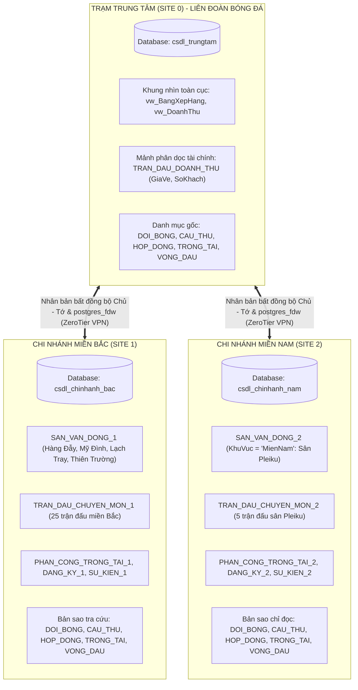

# GIAI ĐOẠN 3: PHÂN TÍCH VÀ THIẾT KẾ CƠ SỞ DỮ LIỆU PHÂN TÁN
**Đề tài 13:** Xây dựng Hệ CSDL quản lý một giải bóng đá chuyên nghiệp  
**Môn học:** Các hệ thống CSDL - M26CQ02 (Nhóm 2)  
**Mô hình kiến trúc:** 3 Trạm (1 Trạm Trung tâm điều hành + 2 Chi nhánh khu vực)

---

## MỤC LỤC
1. [Khảo sát bài toán và Giả thuyết phân tán theo chi nhánh](#1-khảo-sát-bài-toán-và-giả-thuyết-phân-tán-theo-chi-nhánh)
2. [Thiết kế phân mảnh dữ liệu (Fragmentation Design)](#2-thiết-kế-phân-mảnh-dữ-liệu-fragmentation-design)
   * [2.1. Phân mảnh ngang nguyên thủy](#21-phân-mảnh-ngang-nguyên-thủy)
   * [2.2. Phân mảnh ngang dẫn xuất](#22-phân-mảnh-ngang-dẫn-xuất)
   * [2.3. Phân mảnh dọc](#23-phân-mảnh-dọc)
   * [2.4. Nhân bản dữ liệu](#24-nhân-bản-dữ-liệu)
3. [Chứng minh tính đúng đắn của phân mảnh](#3-chứng-minh-tính-đúng-đắn-của-phân-mảnh)
4. [Định vị dữ liệu và Ma trận phân phối](#4-định-vị-dữ-liệu-và-ma-trận-phân-phối)
5. [Sơ đồ kiến trúc CSDL Phân tán tổng quát](#5-sơ-đồ-kiến-trúc-csdl-phân-tán-tổng-quát)
6. [Kịch bản mô phỏng phân tán trên PostgreSQL bằng postgres_fdw](#6-kịch-bản-mô-phỏng-phân-tán-trên-postgresql-bằng-postgres_fdw)

---

## 1. KHẢO SÁT BÀI TOÁN VÀ GIẢ THUYẾT PHÂN TÁN THEO CHI NHÁNH

### 1.1. Bối cảnh bài toán phân tán
Trong thực tế tổ chức giải bóng đá chuyên nghiệp quốc gia, các trận đấu diễn ra phân bố tại nhiều tỉnh thành trên cả nước. Việc tập trung toàn bộ dữ liệu tại một máy chủ duy nhất sẽ bộc lộ các nhược điểm:
* Tăng nghẽn đường truyền mạng diện rộng khi các ban tổ chức trận đấu tại địa phương đồng thời gửi dữ liệu đăng ký danh sách thi đấu và cập nhật diễn biến sự kiện trực tiếp.
* Nếu máy chủ trung tâm gặp sự cố, toàn bộ hoạt động kiểm tra, đăng ký trận đấu tại các sân đều bị tê liệt.
* Chi phí truy vấn dữ liệu cục bộ cao do mọi thao tác kiểm tra danh sách cầu thủ, màu áo, trọng tài đều phải gửi qua mạng về máy chủ trung tâm.

### 1.2. Giả thuyết cấu hình hệ thống phân tán
Hệ thống được thiết kế theo mô hình phân tán gồm **3 Trạm (Sites)** kết nối qua mạng máy tính:
* **Site 0 (Trạm Trung tâm - Trụ sở Ban tổ chức giải đấu)**:
  * Đặt tại trụ sở Liên đoàn Bóng đá.
  * Vai trò: Quản lý tổng thể giải đấu, theo dõi toàn bộ các trận đấu trên cả nước, lưu trữ dữ liệu tài chính bán vé độc quyền (`TRAN_DAU_DOANH_THU`) để kiểm toán và hạch toán doanh thu các sân thi đấu, tính toán chi trả tiền công tổ trọng tài, và tổng hợp bảng xếp hạng, vua phá lưới toàn quốc.
* **Site 1 (Chi nhánh Miền Bắc - Ban điều hành khu vực phía Bắc)**:
  * Trụ sở điều hành đặt tại Hà Nội.
  * Vai trò: Quản lý trực tiếp các sân vận động và tổ chức các trận đấu diễn ra tại khu vực phía Bắc:
    * Sân Hàng Đẫy (`SAN_HD`), Sân Quốc gia Mỹ Đình (`SAN_MD`), Sân Lạch Tray (`SAN_LT`), Sân Thiên Trường (`SAN_TT`).
    * Thực hiện tiếp nhận danh sách đăng ký 18 cầu thủ trước trận, phân công tổ trọng tài tại các sân miền Bắc, cập nhật diễn biến bàn thắng và thẻ phạt trực tiếp tại các trận đấu trên các sân này.
* **Site 2 (Chi nhánh Miền Trung và Nam - Ban điều hành khu vực phía Nam)**:
  * Trụ sở điều hành đặt tại TP Pleiku / TP Hồ Chí Minh.
  * Vai trò: Quản lý các sân vận động và tổ chức các trận đấu diễn ra tại khu vực phía Nam:
    * Sân Pleiku (`SAN_PK`).
    * Thực hiện quản lý điều hành các trận đấu tổ chức trên sân Pleiku.

### 1.3. Bảng số liệu giả định tần suất ứng dụng và truy vấn
Xét chu kỳ 1 vòng đấu (3 trận diễn ra vào cuối tuần):
| Ứng dụng | Mô tả thao tác | Tần suất tại Site 1 | Tần suất tại Site 2 | Tần suất tại Site 0 |
|---|---|:---:|:---:|:---:|
| **App 1** | Tra cứu thông tin đội bóng, cầu thủ, màu áo | 800 lần | 300 lần | 100 lần |
| **App 2** | Đăng ký 18 cầu thủ trước trận đấu | 20 lần | 10 lần | 0 lần |
| **App 3** | Cập nhật tỉ số, sự kiện bàn thắng, thẻ phạt theo phút | 150 lần | 50 lần | 10 lần |
| **App 4** | Thống kê doanh thu vé sân và tính lương trọng tài | 10 lần | 5 lần | 50 lần |
| **App 5** | Quyết toán doanh thu vé sân và tiền công trọng tài mùa giải | 0 lần | 0 lần | 80 lần |

$\rightarrow$ **Nhận xét**: 
* Các thao tác điều hành trận đấu (`TRAN_DAU_CHUYEN_MON`, `DANG_KY_THI_DAU`, `SU_KIEN_TRAN_DAU`) mang tính địa phương cao, diễn ra trực tiếp tại sân vận động tổ chức trận.
* Thông tin danh mục (`DOI_BONG`, `CAU_THU`, `HOP_DONG_CAU_THU`, `TRONG_TAI`, `VONG_DAU`) được đọc rất nhiều tại các chi nhánh nhưng rất ít khi thay đổi.
* Dữ liệu tài chính thương mại bán vé (`GiaVe`, `SoKhach`) chỉ được hạch toán và kiểm toán tập trung tại Ban tài chính trung tâm.

---

## 2. THIẾT KẾ PHÂN MẢNH DỮ LIỆU (FRAGMENTATION DESIGN)

### 2.1. Phân mảnh ngang nguyên thủy (Primary Horizontal Fragmentation)

#### Phân mảnh quan hệ `SAN_VAN_DONG` theo thuộc tính `KhuVuc`
* **Vị từ cơ sở**:
  * $p_1$: `KhuVuc = 'MienBac'` (Khu vực phía Bắc)
  * $p_2$: `KhuVuc = 'MienNam'` (Khu vực phía Nam)
* **Tập các mảnh**:
  $$\text{SAN\_VAN\_DONG}_1 = \sigma_{\text{KhuVuc} = \text{'MienBac'}}(\text{SAN\_VAN\_DONG})$$
  $$\text{SAN\_VAN\_DONG}_2 = \sigma_{\text{KhuVuc} = \text{'MienNam'}}(\text{SAN\_VAN\_DONG})$$
* **Định vị**:
  * $\text{SAN\_VAN\_DONG}_1$ được định vị tại **Site 1** (4 sân miền Bắc).
  * $\text{SAN\_VAN\_DONG}_2$ được định vị tại **Site 2** (Sân Pleiku).

---

### 2.2. Chuỗi phân mảnh ngang dẫn xuất 2 cấp (Derived Horizontal Fragmentation)

#### Cấp 1: Phân mảnh `TRAN_DAU_CHUYEN_MON` theo `SAN_VAN_DONG`
Áp dụng phép bán kết nối ($\ltimes_{\text{MaSan}}$) giữa `TRAN_DAU_CHUYEN_MON` và `SAN_VAN_DONG`:
$$\text{TRAN\_DAU\_CHUYEN\_MON}_1 = \text{TRAN\_DAU\_CHUYEN\_MON} \ltimes_{\text{MaSan}} \text{SAN\_VAN\_DONG}_1 \quad (\text{25 trận miền Bắc tại Site 1})$$
$$\text{TRAN\_DAU\_CHUYEN\_MON}_2 = \text{TRAN\_DAU\_CHUYEN\_MON} \ltimes_{\text{MaSan}} \text{SAN\_VAN\_DONG}_2 \quad (\text{5 trận miền Nam tại Site 2})$$

#### Cấp 2: Phân mảnh `PHAN_CONG_TRONG_TAI`, `DANG_KY_THI_DAU`, `SU_KIEN_TRAN_DAU` theo `TRAN_DAU_CHUYEN_MON`
Áp dụng phép bán kết nối ($\ltimes_{\text{MaTran}}$) với `TRAN_DAU_CHUYEN_MON`:
$$\text{PHAN\_CONG\_TRONG\_TAI}_i = \text{PHAN\_CONG\_TRONG\_TAI} \ltimes_{\text{MaTran}} \text{TRAN\_DAU\_CHUYEN\_MON}_i$$
$$\text{DANG\_KY\_THI\_DAU}_i = \text{DANG\_KY\_THI\_DAU} \ltimes_{\text{MaTran}} \text{TRAN\_DAU\_CHUYEN\_MON}_i$$
$$\text{SU\_KIEN\_TRAN\_DAU}_i = \text{SU\_KIEN\_TRAN\_DAU} \ltimes_{\text{MaTran}} \text{TRAN\_DAU\_CHUYEN\_MON}_i$$
($i = 1$ đặt tại **Site 1**, $i = 2$ đặt tại **Site 2**).

---

### 2.3. Phân mảnh dọc (Vertical Fragmentation)

Áp dụng cho quan hệ `TRAN_DAU`:
* **Mảnh 1 (Chuyên môn thi đấu - 13 cột)**:
  $$\text{TRAN\_DAU\_CHUYEN\_MON} = \pi_{\text{MaTran}, \text{MaVong}, \text{MaDoiNha}, \text{MaDoiKhach}, \text{MaSan}, \text{NgayGio}, \text{BanThangNha}, \text{BanThangKhach}, \text{TheVangNha}, \text{TheVangKhach}, \text{TheDoNha}, \text{TheDoKhach}, \text{TrangThai}}(\text{TRAN\_DAU})$$
* **Mảnh 2 (Tài chính thương mại vé sân - 3 cột)**:
  $$\text{TRAN\_DAU\_DOANH\_THU} = \pi_{\text{MaTran}, \text{GiaVe}, \text{SoKhach}}(\text{TRAN\_DAU})$$
* **Định vị**:
  * $\text{TRAN\_DAU\_CHUYEN\_MON}$ tiếp tục được phân mảnh ngang dẫn xuất theo `SAN_VAN_DONG` về **Site 1** (25 trận) và **Site 2** (5 trận).
  * $\text{TRAN\_DAU\_DOANH\_THU}$ **chỉ lưu trữ độc quyền tại Site 0 (Trạm Trung tâm)** phục vụ kiểm toán doanh thu vé.

---

### 2.4. Nhân bản dữ liệu bất đồng bộ Chủ - Tớ (Asynchronous Master-Slave Replication)

Sáu bảng danh mục dùng chung có tỷ lệ đọc/ghi $> 99\%$ gồm `DOI_BONG`, `MAU_AO_DOI_BONG`, `CAU_THU`, `HOP_DONG_CAU_THU`, `TRONG_TAI`, `VONG_DAU` được triển khai theo cơ chế **Nhân bản bất đồng bộ Chủ - Tớ**:
* **Bản gốc (Master)** đặt tại **Site 0 (Trạm Trung tâm)**: Mọi thao tác cập nhật danh mục đều thực hiện tại Site 0.
* **Bản sao chỉ đọc (Read-Only Replica)** đặt tại **Site 1** và **Site 2**: Giúp các trạm miền thực hiện phép nối cục bộ 100% mà không chịu độ trễ giao thức cam kết hai pha (2PC).

---

## 3. CHỨNG MINH TÍNH ĐÚNG ĐẮN CỦA PHÂN MẢNH

Theo lý thuyết cơ sở dữ liệu phân tán, một thiết kế phân mảnh được coi là chuẩn xác nếu thỏa mãn ba quy tắc cốt lõi:

### 3.1. Tính đầy đủ (Completeness)
* **Đối với phân mảnh ngang `SAN_VAN_DONG` và `TRAN_DAU`**:
  Tập vị từ $\{p_1, p_2\}$ và $\{q_1, q_2\}$ là đầy đủ vì mọi sân vận động trong giải đều thuộc về một trong hai miền Bắc hoặc Nam:
  $$\text{dom}(\text{MaSan}) = \{\text{'SAN\_HD'}, \text{'SAN\_MD'}, \text{'SAN\_LT'}, \text{'SAN\_TT'}\} \cup \{\text{'SAN\_PK'}\}$$
  Do đó, mọi bộ dữ liệu $t \in \text{TRAN\_DAU}$ đều thỏa mãn hoặc $q_1$ hoặc $q_2$, nghĩa là không có trận đấu nào bị bỏ sót ngoài 2 mảnh.
* **Đối với phân mảnh ngang dẫn xuất**:
  Mọi bản ghi trong `PHAN_CONG_TRONG_TAI`, `DANG_KY_THI_DAU`, `SU_KIEN_TRAN_DAU` đều có khóa ngoại `MaTran` tham chiếu đến một trận đấu hợp lệ. Vì `TRAN_DAU` thỏa mãn tính đầy đủ nên các phân mảnh dẫn xuất cũng bảo toàn tính đầy đủ.
* **Đối với phân mảnh dọc `TRAN_DAU`**:
  Tập thuộc tính của quan hệ ban đầu là:
  $$U = \{\text{MaTran}, \text{MaVong}, \text{MaDoiNha}, \text{MaDoiKhach}, \text{MaSan}, \text{NgayGio}, \text{GiaVe}, \text{SoKhach}, \text{BanThangNha}, \dots, \text{TrangThai}\}$$
  Ta có: $\text{attrs}(\text{TRAN\_DAU\_CHUYEN\_MON}) \cup \text{attrs}(\text{TRAN\_DAU\_DOANH\_THU}) = U$.  
  Mọi thuộc tính đều xuất hiện trong ít nhất một mảnh.

### 3.2. Tính tái thiết được (Reconstruction)
* **Đối với các mảnh ngang**: Quan hệ ban đầu được tái thiết trọn vẹn thông qua phép hợp tập hợp:
  $$\text{SAN\_VAN\_DONG} = \text{SAN\_VAN\_DONG}_1 \cup \text{SAN\_VAN\_DONG}_2$$
  $$\text{TRAN\_DAU\_CHUYEN\_MON} = \text{TRAN\_DAU\_CHUYEN\_MON}_1 \cup \text{TRAN\_DAU\_CHUYEN\_MON}_2$$
  $$\text{PHAN\_CONG\_TRONG\_TAI} = \text{PHAN\_CONG\_TRONG\_TAI}_1 \cup \text{PHAN\_CONG\_TRONG\_TAI}_2$$
  $$\text{DANG\_KY\_THI\_DAU} = \text{DANG\_KY\_THI\_DAU}_1 \cup \text{DANG\_KY\_THI\_DAU}_2$$
  $$\text{SU\_KIEN\_TRAN\_DAU} = \text{SU\_KIEN\_TRAN\_DAU}_1 \cup \text{SU\_KIEN\_TRAN\_DAU}_2$$
* **Đối với phân mảnh dọc**: Do cả hai mảnh đều chứa thuộc tính khóa chính `MaTran`, quan hệ toàn cục `TRAN_DAU` được tái thiết qua phép kết nối tự nhiên không mất mát thông tin:
  $$\text{TRAN\_DAU} = \text{TRAN\_DAU\_CHUYEN\_MON} \bowtie_{\text{MaTran}} \text{TRAN\_DAU\_DOANH\_THU}$$

### 3.3. Tính tách biệt (Disjointness)
* Đối với phân mảnh ngang: Vì $q_1 \wedge q_2 = \text{FALSE}$ (một sân vận động không thể vừa thuộc miền Bắc vừa thuộc miền Nam), nên:
  $$\text{TRAN\_DAU\_CHUYEN\_MON}_1 \cap \text{TRAN\_DAU\_CHUYEN\_MON}_2 = \emptyset$$
  Tương tự, các mảnh dẫn xuất không chứa các bản ghi trùng lặp giữa các site.
* Đối với phân mảnh dọc: Giao của hai tập thuộc tính đúng bằng khóa chính:
  $$\text{attrs}(\text{TRAN\_DAU\_CHUYEN\_MON}) \cap \text{attrs}(\text{TRAN\_DAU\_DOANH\_THU}) = \{\text{MaTran}\}$$
  Đảm bảo tính tách biệt của các thuộc tính không khóa.

---

## 4. ĐỊNH VỊ DỮ LIỆU VÀ MA TRẬN PHÂN PHỐI

Ma trận phân phối các mảnh dữ liệu trên toàn bộ 3 trạm của hệ thống:

| Tên quan hệ / Mảnh dữ liệu | Site 0 (Trung tâm) | Site 1 (Chi nhánh Bắc) | Site 2 (Chi nhánh Nam) | Kiểu phân tán |
|---|:---:|:---:|:---:|---|
| `SAN_VAN_DONG_1` | Xem / Quản lý | **Gốc (Đọc/Ghi)** | Không | Phân mảnh ngang |
| `SAN_VAN_DONG_2` | Xem / Quản lý | Không | **Gốc (Đọc/Ghi)** | Phân mảnh ngang |
| `DOI_BONG` | **Gốc (Đọc/Ghi)** | Nhân bản (Đọc) | Nhân bản (Đọc) | Nhân bản toàn phần |
| `MAU_AO_DOI_BONG` | **Gốc (Đọc/Ghi)** | Nhân bản (Đọc) | Nhân bản (Đọc) | Nhân bản toàn phần |
| `CAU_THU` | **Gốc (Đọc/Ghi)** | Nhân bản (Đọc) | Nhân bản (Đọc) | Nhân bản toàn phần |
| `HOP_DONG_CAU_THU` | **Gốc (Đọc/Ghi)** | Nhân bản (Đọc) | Nhân bản (Đọc) | Nhân bản toàn phần |
| `TRONG_TAI` | **Gốc (Đọc/Ghi)** | Nhân bản (Đọc) | Nhân bản (Đọc) | Nhân bản toàn phần |
| `VONG_DAU` | **Gốc (Đọc/Ghi)** | Nhân bản (Đọc) | Nhân bản (Đọc) | Nhân bản toàn phần |
| `TRAN_DAU_CHUYEN_MON_1` | Tổng hợp | **Gốc (Đọc/Ghi)** | Không | Phân mảnh ngang |
| `TRAN_DAU_CHUYEN_MON_2` | Tổng hợp | Không | **Gốc (Đọc/Ghi)** | Phân mảnh ngang |
| `TRAN_DAU_DOANH_THU` | **Độc quyền (Bảo mật)** | Không | Không | Phân mảnh dọc |
| `PHAN_CONG_TRONG_TAI_1` | Xem | **Gốc (Đọc/Ghi)** | Không | Phân mảnh dẫn xuất |
| `PHAN_CONG_TRONG_TAI_2` | Xem | Không | **Gốc (Đọc/Ghi)** | Phân mảnh dẫn xuất |
| `DANG_KY_THI_DAU_1` | Xem | **Gốc (Đọc/Ghi)** | Không | Phân mảnh dẫn xuất |
| `DANG_KY_THI_DAU_2` | Xem | Không | **Gốc (Đọc/Ghi)** | Phân mảnh dẫn xuất |
| `SU_KIEN_TRAN_DAU_1` | Xem / Tổng hợp | **Gốc (Đọc/Ghi)** | Không | Phân mảnh dẫn xuất |
| `SU_KIEN_TRAN_DAU_2` | Xem / Tổng hợp | Không | **Gốc (Đọc/Ghi)** | Phân mảnh dẫn xuất |

---

## 5. SƠ ĐỒ KIẾN TRÚC CSDL PHÂN TÁN TỔNG QUÁT



---

## 6. KỊCH BẢN MÔ PHỎNG PHÂN TÁN TRÊN POSTGRESQL BẰNG POSTGRES_FDW

PostgreSQL hỗ trợ mạnh mẽ cơ chế phân tán thông qua tiện ích mở rộng **`postgres_fdw` (Foreign Data Wrapper)**. Cơ chế này tương đương với `Linked Server` trên SQL Server nhưng có ưu điểm nhẹ hơn, chuẩn hóa và hoạt động ổn định trên mạng máy tính.

Tệp kịch bản mô phỏng phân tán đã được tạo sẵn tại: [`sql/06_distributed_simulation.sql`](file:///d:/Learning/CSDL/sql/06_distributed_simulation.sql).

### Các bước cài đặt mô phỏng trên 1 máy tính:
1. Tạo 3 Schema hoặc 3 Database riêng biệt: `site0_trungtam`, `site1_mienbac`, `site2_miennam`.
2. Trên `site1_mienbac`, lưu trữ các mảnh `_1`.
3. Trên `site2_miennam`, lưu trữ các mảnh `_2`.
4. Trên `site0_trungtam`:
   * Kích hoạt `CREATE EXTENSION postgres_fdw;`
   * Định nghĩa máy chủ ngoại vi (`CREATE SERVER site1_server...`, `CREATE SERVER site2_server...`)
   * Tạo bảng ngoại vi ánh xạ tới Site 1 và Site 2.
   * Tạo View toàn cục kết hợp (Global View):
     ```sql
     CREATE VIEW vw_global_tran_dau AS
     SELECT * FROM foreign_tran_dau_site1
     UNION ALL
     SELECT * FROM foreign_tran_dau_site2;
     ```
   * Khi người dùng truy vấn `SELECT * FROM vw_global_tran_dau`, hệ thống tự động phân rã truy vấn, gửi yêu cầu song song đến cả Site 1 và Site 2, sau đó ghép nối kết quả trả về trong suốt hoàn toàn!
