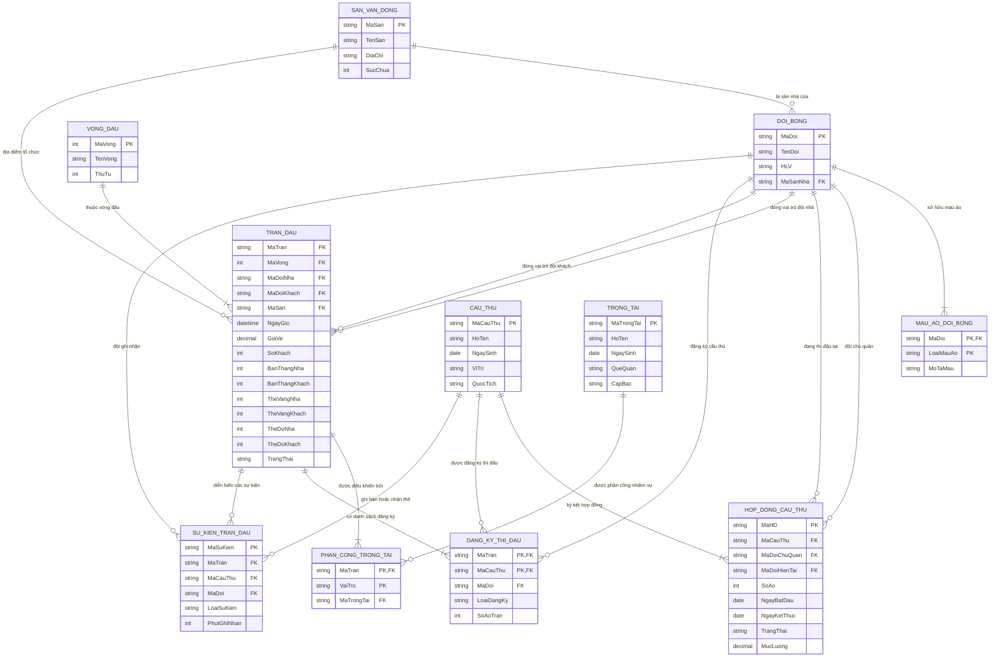
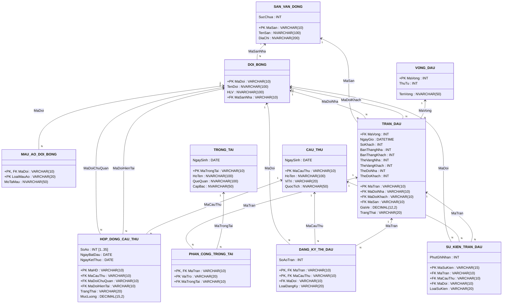
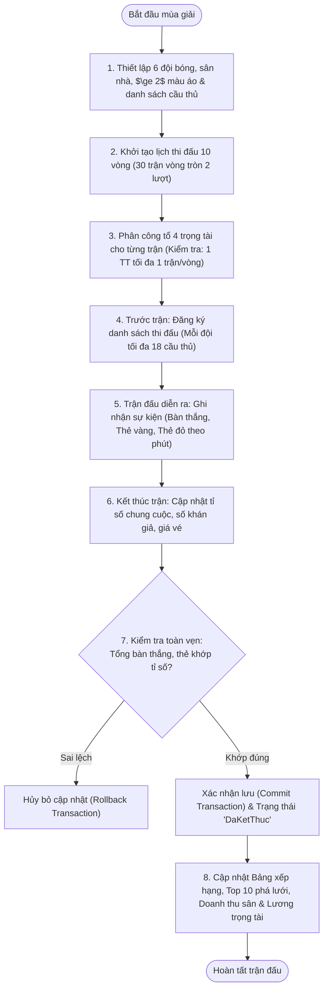
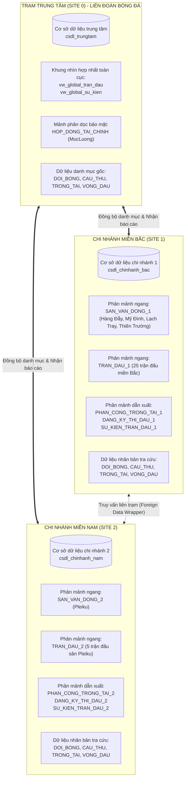

# TẬP HỢP SƠ ĐỒ MERMAID CHO HỆ THỐNG CSDL GIẢI BÓNG ĐÁ
*(Dùng để xem trực tiếp trên GitHub/VS Code Markdown Preview hoặc Import trực tiếp vào Draw.io)*

---

## HƯỚNG DẪN IMPORT VÀO DRAW.IO (3 BƯỚC NHANH CHÓNG)
1. Mở trang [Draw.io](https://app.diagrams.net/) (hoặc ứng dụng Draw.io Desktop).
2. Trên thanh menu, chọn: **Arrange** $\rightarrow$ **Insert** $\rightarrow$ **Advanced** $\rightarrow$ **Mermaid** (hoặc tiếng Việt: **Sắp xếp** $\rightarrow$ **Chèn** $\rightarrow$ **Nâng cao** $\rightarrow$ **Mermaid**).
3. Copy toàn bộ đoạn mã trong khối ` ```mermaid ... ``` ` tương ứng bên dưới và dán vào hộp thoại, sau đó nhấn **Insert**. Draw.io sẽ tự động dựng toàn bộ hình khối, liên kết có thể kéo thả, đổi màu sắc và xuất ảnh (PNG, SVG, PDF) cho báo cáo.

---

## 1. SƠ ĐỒ THỰC THỂ LIÊN KẾT (E-R DIAGRAM CHI TIẾT)



---

## 2. SƠ ĐỒ LƯỢC ĐỒ QUAN HỆ VẬT LÝ (RELATIONAL SCHEMA DIAGRAM)



---

## 3. SƠ ĐỒ QUY TRÌNH NGHIỆP VỤ ĐIỀU HÀNH TRẬN ĐẤU (BUSINESS PROCESS)



---

## 4. SƠ ĐỒ KIẾN TRÚC CƠ SỞ DỮ LIỆU PHÂN TÁN (DISTRIBUTED ARCHITECTURE)


